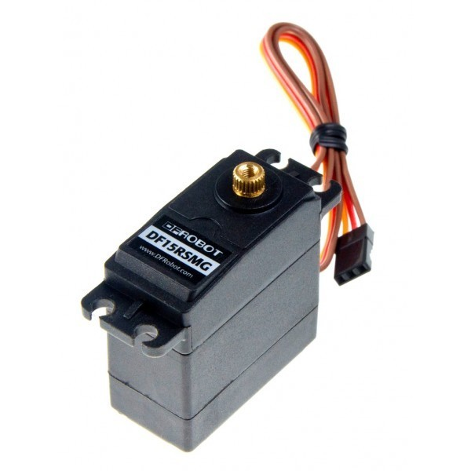
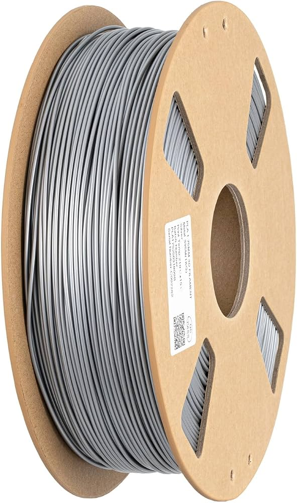
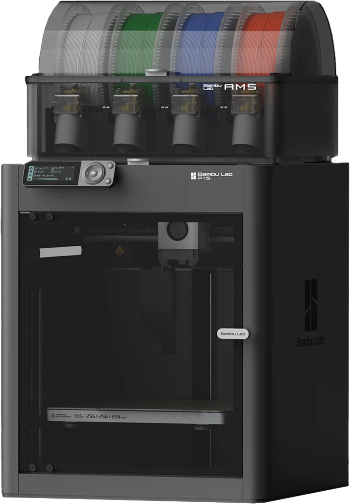

# Teleco Games

Bienvenidos al proyecto número 4 en nuestra asignatura de Tecnología llamado Teleco Games. En esta ocasión, vamos a trabajar de cara a los Teleco Games, unas olimpiadas de Telecomunicaciones. Los Teleco Games en la provincia de Jaén son la fase clasificatoria local de las Olimpiadas Nacionales de Telecomunicaciones. Esta competición educativa está diseñada para estudiantes de ESO, Bachillerato y Ciclos Formativos de Grado Medio y Superior con el objetivo de fomentar el talento joven, la cultura científica y las vocaciones en el ámbito de las ingenierías STEM (Ciencia, Tecnología, Ingeniería y Matemáticas). Nosotros vamos a participar en la modalidad de equipos (ya que la modalidad individual está reservada para alumnos de Bachiller). Grupos de entre 2 y 6 estudiantes diseñan, construyen y programan un prototipo tecnológico funcional. Este proyecto debe integrar sistemas de comunicación y proponer soluciones a problemas sociales y medioambientales alineados con los Objetivos de Desarrollo Sostenible (ODS) de la Agenda 2030, empleando tecnologías como el Internet de las Cosas (IoT), Inteligencia Artificial o herramientas de ciberseguridad. Como en clase somos 8 personas, nos hemos dividido en dos grupos de 4. 

Los grupos son los siguientes:

| Nombre del equipo | Integrantes |
| --- | --- |
| ``Error 404-Cerebro no encontrado`` | Lorenzo Manuel Latorre Martínez, Noah Lee Aguilar Schneider, Guillermo Cuesta Luque y Marco Fernández Manzaneda |
| ``Los Hacker-Crustáceos`` | Alejandro Reyes Delgado, Adrián Ordóñez Hernández, Daniel Boyano Lomas y Alberto Piñar López |

## 1ª parte del proyecto: Desarrollo individual de una idea inicial

En esta primera parte del proyecto, vamos a seguir los pasos del primero. Primero vamos a desarrollar una idea primeriza que nos ayudará a situarnos en el tema. Posteriormente, nos juntaremos en parejas con la misma persona que en el proyecto 1. Y, finalmente, nos juntaremos en gran grupo para decidir una idea que posteriormente pondremos en marcha para los Teleco Games.

En mi ocasión, he utilizado la IA de Google, Gemini, para que me aporte una lluvia de ideas con la que poder comenzar. Me ha comentado varias opciones, tales como una papelera inteligente, que detecte cuando está llena o vacía y te avisa por una nontificación en el teléfono o un chat bot en la app Telegram; también un sistema de riego, utilizando bombas de agua con temporizador controladas por una placa bien sea Arduino, ESP32, Raspberry Pi y demás; y por la que finalmente me he decantado como inicio, una caseta inteligente para pájaros, pricipalmente.

### Desarrollo de la idea
Ahora que he mencionado mi idea paso a desarrollarlla. Los principales elementos que utilizaríamos serían los siguientes (los cuales explicaré cada uno): placa ESP32 o Arduino (preferiblemente ESP32 ya que cuenta con módulo Wi-FI y Bluetooth, crucial para el requisito de telecomunicaciones), servomotor, bomba de agua, impresora 3D, cortadora láser, placa solar en miniatura para la alimentación de componentes y placa, módulo de gestión de la carga de las placas solares y pilas para almacenar esa carga, sensor de ultrasonidos, sensor de infrarrojos, sensor de humedad, sensor de temperatura, contrachapado de madera y cables, además de un ordenador para diseñar y programar el código que vayamos a utilizar.

Lo primero que habría que hacer es pensar en qué zonas colocar estas casetas. Lo que he pensado, y lo que más lógica tiene, sería en la entrada de nuestro instituto, ya que colocarlo en parques dificultaría mucho el tema de la alimentación de los componentes, además del montaje de la misma caseta. La idea es montar la caseta con contrachapado de madera utilizando la cortadora láser, y posteriormente las cubiertas para los componentes eletrónicos (principalmente para que los pájaros que se encuentren dentro no puedan romper los componentes) imprimirlas en 3D, de las cuales ya se estudiaría el material con el que se imprimiría. 

Ahora, vamos a explicar un poco lo que va a hacer la placa. La placa ESP32, como pequeño resumen, es una tarjeta de desarrollo de bajo costo y consumo de energía muy utilizada en proyectos de Internet de las Cosas (IoT) y robótica. Es muy versátil y útil, y tiene el rol de ser el cerebro del proyecto. Tiene mucha potencia, consume muy poco, se le pueden conectar todo tipo de componentes electrónicos (a través de sus pines GPIO) y tiene conectividad Wi-Fi y Bluetooth. Esta placa va a controlar todos los componentes electrónicos (sensores, servomotor y bomba de agua), además de convertirse en el mensajero de información a nuestro teléfono utilizando principlamente la conectividad Wi-Fi, la cual tiene más alcance que el Bluetooth.

Ahora pasamos a la parte de explicación de las funciones de los componentes que vamos a utilizar en esta idea, empezando por el servomotor y la bomba de agua. Primero, el servomotor. Este se va a encargar de abrir y cerrar la compuerta del dispensador de comida para los pájaros. Va a estar controlado por la placa, obviamente, además de por los sensores de infrarrojos, para regular cuando colocar comida en la caseta para que el pájaro en cuestión se alimente. Segundo, la bomba de agua. Esta va estar conectada a un contenedor de agua, cuya función principal va a ser verter agua en un recipiente para que los pájaros puedan beber, regulada también por los infrarrojos y la placa. 

Después, tenemos a los sensores de infrarrojos, humedad, temperatura y ultrasonidos. Los sensores infrarrojos, sencillamente, van a enviar la señal a la placa de cuando entra o sale un pájaro. Solo se va a encargar de eso. Despiués, los sensores de teperatura y humedad se van a encargar de comprobar la calidad del interior de la caseta, para conocer si está en unas buenas condiciones para que los pájaros se encuentren dentro. Y, los ultrasonidos, van a detectar la cantidad de comida que tiene el depoósito a través de la distancia. Si detecta que la distancia que hay entre el principio y el fin del contenedor es considerable, entonces se envía una señal para recordar que el contenedor se debe rellenar.  

Digamos que estos componentes que voy a explicar ahora son provisionalmente opcionales. Me explico, las mini placas solares, el módulo de gestión de la carga de estas, además de la placa que las controle, solo se van a utilizar en caso de que el presupuesto nos lo permita. En los Teleco Games, el presupuesto máximo que tenemos para realizar nuestrto proyecto, incluyendo todos los componentes (aunque los tengamos en el centro) a valor de mercado, es de 200€. Tales como la impresora o la cortadora láser no se contarían porque de por sí sobrepasan el presupuesto con creces, se utilizan para realizar otros componentes que si están presentes en el proyecto. Cone esto quiero decir que, si se sobrepasa del presupuesto, se utilizaría sencillamente un portapilas con sus correspondientes pilas, y cuando se estén acabando sin carga se recargan y se cambian. La ventaja que tienen estas placas es que automatizas del todo el proyecto, pero tammbién pueden ser caras y sobrepasarse del presupuesto. Ya en tal caso deberíamos de seleccionar los componentes imprescindibles y los que podemos omitir. 

Para finalizar, tenemos la cortadora láser y la impresora 3D. Los modelos de cada cosa los completaré posteriormente porque no tengo idea de las que se encuentran en el centro, pero nos van a ayudar a imprimir nuestros diseños en 3D y a cortar nuestra madera de forma más sencilla. Los diseños en 3D se imprimen con la impresora 3D y la madera se corta y se trabaja con la cortadora láser. 

Ahora bien, es necesario tener un sistema de ciberseguridad. Lo principal seguridad que se utilizaría aquí sería un usuario y una contraseña en una página web. Quiero decir, se utilizaría una página web en la que se puedan ver en tiempo real los valores que leen los diferentes sensores, a la que solo podrían acceder usuarios autorizados. También he pensado en implementar un sistema de lectura de una llave física, como un chip NFC o una llave de seguridad USB, como las que utilizamos para acceder por ejemplo a nuestras cuentas de Google.

## 2º parte del proyecto: Elección grupal de la idea a desarrollar.

Después de debatir sobre las diferentes ideas del grupo, finalmente nos hemos decantado por mi idea, la caseta inteligente para pájaros. Hemos modificado y añadido diferentes elementos pensando en la posibilidad de poder montar tanto técnicamente como económiocamente el proycto. 

## Medidas y lugar de los componentes en el techo
Como primera fase de desarrollo, propusimos las medidas, para nosotros ideales, que debería de tener la caseta. En principio, va a ser cuadrada, con 25x25x25 cm (iguales medidas para anchura, altura y profundidad), con una puerta en forma circular de 12 cm de diámetro y un techo de 8 cm de altura en forma de triángulo sin base, como las típicas casitas de los cuentos. 

En segundo lugar, pensamos en los lugares donde debían estar todos los componentes, ya que había que tener en cuenta que no pueden bajo ningún concepto estar al alcance del pájaro del interior ya que tendería a picotearlo o romperlo. Esto nos llevó a la decisión de colocar todos los componentees en el techo, ya que va a tener el suficiente espacio para ello. Al estar hueco  y tener una altura considerable, caben de sobra los componentes que no pueden estar a la vista, como son el sensor de ultrasonido, la placa, el sensor de humedad y temperatura y los cables. De esta manera, no serán visibles para el pájaro y podrán funcionar perfectamente sin necesidad de arriesgarse a que los componentes se deterioren. Para el sensor de humedad y temperatura, hemos inventado una especie de soporte para que, desde el techo, pueda analizar el ambiente en la caseta. Ahora mostraré una foto con él. 

## Lugar de los componentes en el interior de la caseta
El techo debe de tener una serie de agujeros para que los sensores puedan detectar los valores que necesiten leer (en este caso el de humedad y temperatura y el de ultrasonidos para la cantidad de comida, de la que hablaremos posteriormente). Con esto, pasamos al interior de la caseta. Aquí, solo se van a encontrar, el dispensador de comida, el recipiente donde va a caer la comida, el dispensador de agua y el sensor de movimiento para detectar cuando entra y salen los pájaros. Vamos por partes:

·El dispensador de comida va a ser muy sencillo, una cajetilla en forma rectangular con una trampilla que va a estar controlada por el servomotor para dejar caer la comida del interior. Para controlar el servomotor, el sensor de presión va a ser el encargado de decir cuando va a echar comida y parar de hacerlo. Este se va a encontrar debajo del recipiente donde va a caer la comida, y al detectar la presión dependiendo del nivel de comida que tenga el recipiente continuará el servo dejando pasar la comida o no. Se verá má claro con el mntaje realizado. Después, para detectar cuánta comida hay en el dispensador, entra el ultrasonido en acción. Este, según la distancia que haya entre la comida y el sensor, va a enviar las señales a la placa. Si hay un nivel de distancia considerable entre el sensor y la comida, este enviará la señal de que hay que rellenar el dispensador. Por eso, en la base del techo se realizarán una serie de agujeros que permitan a los sensores detectar los diferentes valores necesarios. Por lo tanto, el dispensador de comida por arriba no tendrá ninguna tapadera, porque estará abierta para el ultrasonido posicionado en el techo.

·El dispensador de agua va a ser parecido al que tienen los hamsters pero con pequeñas modificaciones. 

·El sensor de movimiento se va a posicionar con un soporte justo en la entrada de la caseta, un poco escondido para que el pájaro no se percate de él. Como su propio nombre indica, se va a encargar de detectar el movimiento del pájaro al entrar y salir de la caseta. Según Antonio, va a ser un poco complejo de calibrar, pero una vez realizada la calibración, no hará falta hacer más nada. Este va a ir sujeto a la parte de dentro de la puerta, lo más pegado posible a la pared para que sea lo menos visible posible. 

El emplazamiento que se había pensado principalmente para la caseta en el instituto va a seguir así, pero hay que pensar dónde exactamente. Hemos debatido ideas yu pensado que en el mejor lugar donde se puede colocar es a la entrada del instituto, donde se encuentran los diferentes árboles o donde se encuentra la pista de fútbol, en la parte trasera del centro. Posterior a los Teleco Games, se estudiará la idea y se decidirá un sitio fijo.

Para que los cables no estén a la vista de los pájaros, se imprimirán una serie de canaletas en las que se encuentren dentro los cables. Principalmente, va a ir dirigido al servomotor del dispensador de comida y al sensor de movimiento

## Tabla de componentes, materiales y dispositivos de fabricación
Aquí tenemos una tabla con los diferentes componentes y materiales que se van a utilizar para este proyecto, explicando también la función que va a tener cada uno: 

| Materiales, componentes y dispositivos de fabricación | Función | Imagen de cada uno de los componentes |
| --- | ---| --- |
| ``Sensor de movimiento (PIR)`` | Este se va a encargar de detectar cuando entra o sale un pájaro de la caseta. Solo tiene dos valores, ``HIGH`` o ``LOW``. | |
| ``Sensor de temperatura y humedad`` | Como dice su nombre, este va a detectar la temperatura y la humedad, la calidad de la caseta y de como se va a encontrar dentro el pájaro de la caseta. |  |
| ``Sensor ultrasonido`` | Se va a encargar de detectar la cantidad de la comida en función de la distancia que lea. Si detecta que hay mucha distancia, mandará la señal de rellenar el dispensador. |  |
| ``Sensor de presión`` | Detectará la cantidad de comida que se encuentra en el comedero. Si detecta que hay mucha comida, le dirá al servomotor que no eche comida, y si hay poca, le dirá que eche. |  |
| ``Servomotor`` | Se encargará de regular la trampilla que dejará pasar la comida. Estará regulado casi en su totalidad por el sensor de ultrasonido y de presión. |  |
| ``Placa ESP32 Plus`` | Se va a encargar de controlar todos los componentes, absolutamente todos.|  |
| ``Depósito-dispensador de comida`` | Este es el que va a tener la comida dentro. No tendrá tapa, para que el ultrasonido detecte la cantidad de comida. |  |
| ``Sensor de nivel de agua (x2)`` | Detectará el nivel de agua que tiene tanto el dispensador de agua como el depósito. |  |
| ``Dispensador de agua`` | Ahí se encontrará el agua después de haber pasado por la bomba y el tubo y será de donde directamente beba el pájaro el agua. |  |
| ``Bomba de agua+tubo`` | La bomba de agua se encargará de recebar el agua a través del tubo en el dispensador de agua. |   |
| ``Depósito donde guardar el agua`` | Se encargará de guardar el agua que posteriormente va dirigida al dispensador. |  |
| ``Cables`` | Conectarán todos los componentes a la placa. |  |
| ``Madera contrachapada`` | Material que utilizaremos para crear la estructura de la caseta. |  |
| ``Filamento`` | Material del que ya veremos el tipo que utilizaremos para imprimir las estructuras que deseemos en 3D. |  |
| ``Cortadora láser`` | Nos ayudará a crear y cortar la madera congtrachapada para la estructura de la caseta. |  |
| ``Impresora 3D`` | Imprimirá las canaletas de los cables y otros elementos (como el dispensador de comida y agua). |  |

## Ciberseguridad y página web
Para poder controlar los diferentes valores que recibamos de la caseta, hemos pensado en crear una página web, a la que la placa va a enviar todos esos valores. Se va a comunicar por Wi-Fi, al estar disponible ya que en el centro tenemos y también porque tiene un mayor rango que el Bluetooth. Esta página web en cuestión va a tener diferentes apartados donde vamos a poder concocer la temperatura y el nivel de humedad, la cantidad de comida que hay en el dispensador, el nivel de agua que que tiene el dispensador o el depósito, la cantidad de comida que hay en el comedero, etc. En general, todos los valores se van a poder ver aquí. No todo el mundo va a poder acceder a la página web, solo usuarios autorizados que accedan a ella mediante un usuario y una contraseña o una llave de seguridad física (ya sea una llave USB o un chip NFC). 

## Diseño en papel de la caseta
Nuestro compañero Guillermo se ha encargado de realizar un boceto sencillo de la caseta. Aunque sea sencillo, está bastante claro y algunos lugares de los componentes pueden ser definitivos. Aquí debajo podemos ver el diseño:

## Diseño de la caseta en Tinkercad
Por mi parte, he realizado una maqueta en Tinkercad de la caseta a escala real. Por aquí debajo podemos ver como tenemos la puerta, la caseta y el tejado donde vamos a guardar los componentes. Posteriormente, el diseño y la colocación de los componentes será mucho más exacto en el futuro. Podemos verla aquí:

## Objetivos de Desarrollo Sostenible que cumplirá esta caseta.
El objetivo principal de los Teleco Games es realizar un proyecto que cumpla con alguno de los 17 OODS que se plantean en la Agenda 2030. 

Posteriormente se completará este apartado del proyecto conforme vayamos trabajando en él a lo largo del curso. 

